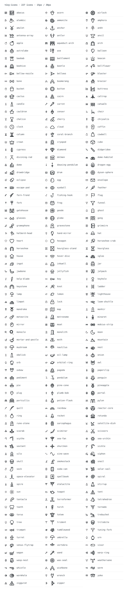
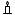

# tiny-icons

A set of small, stroke-only SVG icons drawn on a 15 × 15 grid. They are made to stay legible at 15 px and to scale cleanly to any larger size.



## Contents

```
icons/                    one SVG per icon (kebab-case name)
preview.png               the grid above, generated by scripts/render-preview.mjs
scripts/render-preview.mjs   renders preview.png (three columns, 15px + 30px + name)
scripts/check-icons.mjs      lints every icon against the style rules below
scripts/inspect-icons.mjs    design aid: enlarged 1x pixel view + vector-on-grid view
```

## Using the icons

Every icon uses `stroke="currentColor"`, so it takes the text colour of wherever it is placed.

```html
<!-- inline: inherits color, can be styled -->
<span style="color: #c2410c">…paste icons/candle.svg here…</span>

<!-- as an image: always renders black -->


<!-- as a CSS mask: any colour, no inline markup -->
<i class="icon" style="--icon: url(icons/candle.svg)"></i>
<style>
  .icon { display: inline-block; width: 15px; height: 15px; background: currentColor;
          -webkit-mask: var(--icon) center / contain no-repeat;
          mask: var(--icon) center / contain no-repeat; }
</style>
```

You can display them at 15 px or at any whole multiple of it (30, 45, 60 …). The stroke scales with the icon: it is 1 px at 15 px and 2 px at 30 px. At sizes that are not multiples of 15, straight lines can fall between pixels and look soft.

## Scripts

```sh
npm install
npx playwright install chromium   # one-time, if Chromium isn't already available

npm run render                    # regenerate preview.png  (--scale 1 for true 1x pixels)
npm run check                     # lint all icons; exits 1 on errors
npm run inspect -- moon key       # write inspect.png for the named icons (all if none given)
```

---

## Guide for agents: adding icons in this style

These are the rules and lessons from drawing the first 50 icons. Follow them and run the checks so that new icons match the set.

### 1. File template

Every file has exactly this root element. Style is set only on the root. Child elements carry geometry only.

```svg
<svg xmlns="http://www.w3.org/2000/svg" width="15" height="15" viewBox="0 0 15 15" fill="none" stroke="currentColor" stroke-width="1" stroke-linecap="round" stroke-linejoin="round">
  <path d="…"/>
</svg>
```

- Save it as `icons/<name>.svg`, using a lowercase kebab-case singular noun (`soda-can`, `hand-mirror`).
- Allowed elements: `path`, `circle`, `ellipse`, `line`, `polyline`. Allowed child attributes: geometry only (`d`, `cx`, `cy`, `r`, `rx`, `ry`, `x1`…, `points`) plus `transform="rotate(…)"`.
- No fills, no `<rect>`, no `<polygon>`, and no `Z`/`z` in paths (see §3). `npm run check` enforces all of this.

### 2. Grid and pixel alignment

- **Safe area:** keep the painted stroke inside 1 → 14. Path coordinates should therefore stay within **1.5 → 13.5**. The check script warns when an icon enters the 1 px margin and fails when it leaves the canvas.
- **Put straight lines on half coordinates.** A 1 px stroke centred on `x = 4.5` fills exactly one pixel column. Centred on `x = 4` it smears across two grey columns. Every horizontal and vertical segment should sit on `.5` (for example `M4.5 1.5V13.5`).
- **Circles:** use a `.5` centre with a whole-number radius (`cx=7.5 r=6`) so the top, bottom and side extremes land on whole pixels. The canvas centre is `7.5, 7.5`, and the largest round icon uses `r=6` (clock, globe, button).
- **Keep parallel strokes 2 units apart** centre to centre, which leaves a 1 px gap. At 1.5 apart they merge into a grey bar at 15 px. This applies to tube outlines (bone shaft, hand-mirror handle, cactus arms, paperclip loops), ladder rungs and tornado bands.
- Diagonals and curves will always be anti-aliased at 15 px, and that is fine. Where the object allows it, build the main structure from crisp verticals and horizontals: ladder, candle, gravestone, cactus, comb, door and envelope all do this, and they are the sharpest icons at 15 px.

### 3. Rendering quirk: avoid `Z`

In Chromium, at 1×, a subpath closed with `Z` (and any `<rect>`) gets a faint one-pixel halo along the closing edge. Open paths do not get it. `stroke-linecap="round"` makes the seam invisible, so:

- **Close shapes by ending the path on its start point**, without `Z`: `M7.5 6.5H9.5V13.5H5.5V6.5H7.5`.
- **Start closed outlines partway along a straight edge** rather than at a corner (`M7.5 7.5H1.5…` for the mushroom cap). This gave the cleanest result.
- Write rectangles as paths in the same way.

### 4. Dots

To draw a dot, use a zero-length subpath: `M6 6h0`. With round caps it renders as a 1-unit dot. It is used for eyes, mushroom spots, button holes and tentacle suckers. Use it sparingly, because at 15 px a dot is a single pixel.

### 5. Design principles

- **The silhouette must identify the object at 15 px.** Interior details are mainly for 30 px and up. Use about 1–7 elements and at most about three interior details. If removing a detail makes no difference at 15 px, remove it.
- **Use flat, front or side views.** Perspective and three-quarter views did not read at this size.
- **Use outlines (a 2-unit-wide tube) for parts with mass**, such as handles, arms, bones and worms. Use a single stroke for thin things such as stems, strings, antennae, spars and blades.
- **Keep a consistent optical size.** Most icons fill about 12 units on their longer axis (1.5 → 13.5). Narrow objects (candle, hand mirror, paperclip) still use the full height.
- **Prefer computed geometry to guessed curves.** Building from circles and arcs whose intersections you calculate gave cleaner results than freehand Béziers:
  - moon: a circle minus an offset circle, using the two intersection points
  - cloud: three arcs meeting at shared points
  - bone: two overlapping knob circles at each end
  - worm: concentric arcs with r = 1.25 and 3.25 around the same centres
  - snail: semicircles whose radius grows by 1 each half-turn, with the last quarter-turn landing exactly on the foot line so the shell sits on the body
  - pineapple, sun, sea urchin: crosshatch chords and ray endpoints computed from the ellipse/circle equations
  - nautilus: a logarithmic spiral sampled every 30° and smoothed (Catmull-Rom to cubic Béziers)
  - horseshoe crab, bellows: drawn on a local axis, then rotated 45° so a long body fits the diagonal
  - A short Python or JS snippet is enough to find circle intersections.
- **Arc flags:** SVG's y-axis points down, so `sweep-flag=1` means clockwise on screen. If an arc bulges the wrong way, flip the sweep flag. If it takes the long way round, flip the large-arc flag.
- **Be careful with round caps near the edge.** A cap extends 0.5 past the endpoint, so a stroke ending at `y=1` paints up to `0.5`.

### 6. Lessons from specific icons

| Problem | What failed | What worked |
|---|---|---|
| Eyeball was not recognised as an eye | Sphere with an offset elliptical iris (read as a target, a fish or a radio button; rejected in review) | **Almond eye** outline with a round iris and a pupil dot |
| Moth read as a butterfly | Four separate upright wings | Two swept-back **delta** wings, as a moth holds them at rest, plus curled antennae |
| Hammer read as a T or a ray gun | Long wedge head with a separate face line | A square **striking face** on one side, a thin neck and a **curved claw** on the other, all one outline with the handle |
| Axe read as a megaphone | Blade drawn with straight edges converging on the handle | **Concave** top and bottom edges (a bearded blade) with a convex cutting edge |
| Whistle read as a "9" or a snail | Short mouthpiece on a large round chamber | **Long flat mouthpiece** tangent to a smaller chamber, plus a pea and an air slot |
| Shell (conch) read as a leaf, acorn or shield | Symmetric upright cone; plain diagonal teardrop | Diagonal shell with a **stepped spire** at the top right and a wide aperture lip sweeping to the canal at the bottom left |
| Teapot spout looked like a stick | Single-stroke spout | An **outlined**, tapering spout with an open tip, like the other parts that have mass |
| Snail shell looked like it was floating | Spiral drawn as a separate circle above the foot | The spiral's last arc **ends on the foot line**, so the shell and body share a point |
| Lighthouse rays looked like part of the building | Two rays touching the lamp room | Three short rays per side with a **gap** between them and the tower |
| Zipper read as a stick figure | Teeth only above the slider, with the tapes splaying out below | Teeth above and below a **square slider**, with the pull tab sticking out to the side |
| Tornado read as an "align" or menu icon | Straight horizontal bars | The same bars, **slightly curved** and staggered |
| Wishbone read as a caret (^) | Single stroke with a knob | **Outlined** tube shape with a rounded apex |
| Antler read as a twig | Single antler | A **pair** of antlers |
| Worm was muddy at 15 px | Diagonal tube | Horizontal S-curve built from concentric arcs, with a band line near the head |
| Pineapple and igloo turned into grey blobs | Dense crosshatch or brick courses spaced under 2 units | Two crosshatch lines per direction, **4 units** apart; one brick course with two joints |
| Tree read as a cloud, then a lollipop | Three-bump cloud canopy with a branch inside; then an oval on a single-line stick | A smooth canopy with a **flattened base** and a 2-unit **outlined trunk** on a ground line |
| Pineapple read as a firework or an egg wearing a crown | Round body with five splayed leaves; then a zigzag crown | **Taller oval** body and three upright leaves |
| Rocket window read as a door | Circle in the fuselage | No window: body, fins and exhaust are enough |
| Hourglass didn't read as an hourglass | Curves meeting in an X | **Rounded bulbs** that stay wide, then pinch to a narrow waist, plus sand at the top and bottom |
| Key bow and blade looked like separate parts | Circle placed next to the blade | One outline: the blade lines start where they **meet the circle**, and the arc closes the bow |
| Astrolabe read as a "no entry" sign | Circle crossed by a diagonal rule | An offset inner ring, a centre dot and edge ticks; **avoid a single diagonal across a circle** |
| Tumbleweed drew a pentagram | Star-polygon scribble (even angle steps) | Circle plus three irregular strands. **Check every scribble for accidental symbols** |
| Sextant read as a party hat | Bare 60° sector | An inner bracing arc, an index arm that overshoots the scale, and a telescope |
| Jawbone read as a bathtub or ruler | Rectilinear L shape | One curved band with a condyle knob and short teeth |
| Torus read as lips at 15 px | Crossing smile and frown arcs | Outer ellipse, a small inner ellipse and one lower shading arc |
| Eclipse sun arc went the wrong way | Hand-picked SVG arc flags | **Sample** the sun circle and keep only the points outside the moon |
| Monocle read as a magnifying glass | Single ring with a solid chain line | A double ring and a **dotted** chain made from `h0` dots |
| Snail shell still looked detached | Spiral that only touched the foot at one tangent point | Give the snail a **2-unit foot**: the last whorl rests on the foot's top edge and the shell's back drops straight down onto it |
| Wagon read as a shopping cart | Open box on wheels with a long handle | **Covered wagon**: an arched canvas bonnet with hoop lines over two wheels |
| Tumbleweed was too geometric, then drew stars | Circle with neat strands; even-step scribbles (pentagrams) | A seeded random closed scribble with uneven angle steps (115–165°) and radii, about 8 points. Look at several seeds and reject any that read as a star |
| Dolmen read as a Greek temple | Rectangular uprights (four parallel verticals) | **Irregular, rounded** stones and a tilted capstone |
| Stirrup read as a bell | Dome-shaped arch | **Straight sides** narrowing to a small rounded top, a flat tread and a strap slot |
| Wasp nest read as an Easter egg | Egg with regular wavy or scalloped bands | An **asymmetric** nest with uneven bands that stop short, and an entrance hole off to one side |
| Mandrake read as an insect | Thin antenna-like leaves, six limbs and eye dots | **Broad leaves**, a turnip-like body with legs, short drooping arms and no face |
| Pine cone read as an Easter egg | Zigzag rows | **Curved crosshatch** on a shape that tapers to a point at the bottom |
| Coral read as a molecule diagram | Single strokes with circles on the tips | One outlined shape of **2-unit-wide fingers** with rounded tips |
| Hourglass top sand didn't read as sand | A single flat line | A **sunken (crater) surface** in the top bulb and two falling-sand dots below the waist |
| Ingot looked flat | Two stacked trapezoids | A 3/4 view: front, top and side faces drawn with one oblique depth vector |
| Igloo was too squat and the bricks were unclear | Low dome with scattered joints | A taller half-ellipse (rx 6, ry 8), three courses and **staggered** joints |
| Nest looked geometric | A smooth bowl with two crossing lines | Overlapping straight **sticks** at different angles, with ends poking past the outline |
| Caltrop was too thin, then read as a plane or arrowhead | Thin spikes; a star polygon | Four wide cones that **overlap** at the centre |
| Accidental symbols | Triangle plus circle (an eye of providence); crossbars on masts (crucifixes); a cloud on a tower (mushroom cloud) | Check every new icon for unintended symbols, and change the motif if one appears |
| Removed by the owner after review | compass, needle, bell, doorknob, thimble, trapdoor, pillow, kite, saw, hammer, door, comb, crucible, pitcher-plant, seed-pod, shell, sundial, spindle, bagpipe, barnacle, retort-flask, bullroarer, ocarina, shoe | — (don't re-add them without asking) |

If an icon fails review twice, look at how established icon sets draw the same object. The `@iconify-json/*` packages on npm are an easy source of reference silhouettes. Use them only to understand the shape, and draw your own version on this grid.

### 7. Workflow checklist

1. Sketch the icon on the 15 × 15 grid. Decide which strokes can be crisp verticals or horizontals.
2. Write `icons/<name>.svg` using the template.
3. Run `npm run inspect -- <name>` and open `inspect.png`. Check the left panel, which is the true 15 px rendering: look for grey smears where lines should be crisp, merged strokes and unreadable details. Fix them and repeat.
4. Run `npm run check`. It must finish with 0 errors, and should finish with 0 warnings.
5. Run `npm run render` and look at the new icon beside its neighbours in `preview.png`. Check its weight, size and level of detail against the rest of the set.
6. Commit the SVG together with the regenerated `preview.png`.
